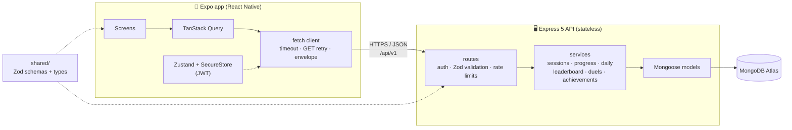

<div align="center">


# Luna

**Train your engineering intuition, one five-minute kata at a time.**

A mobile game for computer science students: predict what code prints, find the buggy line, pick
the better engineering trade-off, and work through a simulated production incident. You get
explained feedback after every answer.


[Why Luna](#why-luna) · [Features](#features) · [How it works](#how-it-works) ·
[Getting started](#getting-started) · [API](#api-reference) · [Engineering notes](#engineering-notes) ·
[Docs](#documentation)

</div>

---

## Why Luna

CS students meet the event loop, SQL indexes and cache invalidation across many courses and
videos, but they rarely practise _applying_ them. Video courses are passive. LeetCode-style
problems need long sessions. Nothing lets a student spend five minutes on engineering judgement,
such as _"which line is the bug?"_ or _"latency just spiked, what do you check first?"_, and get
an explanation right away.

Luna fills that gap with short sessions that work like a game, and it keeps track of what you're
weak at.

|                      |                                                                                                                                 |
| -------------------- | ------------------------------------------------------------------------------------------------------------------------------- |
| **Who it's for**     | CS students (18–24) first; early-career developers refreshing fundamentals second                                               |
| **Session length**   | 4–6 minutes. The Daily Kata is 5 challenges (7 answers)                                                                         |
| **What it measures** | Effort as **XP and samurai ranks**, skill as **moon-phase mastery** per topic. The two never mix                                |
| **Theme**            | A night dojo: calm, dark, one moon-gold accent. The theme lives in names and visuals; the questions stay plain, precise English |

---

## Features

### Four game modes

| Mode                     | What you do                                                                                    | Example                                            |
| ------------------------ | ---------------------------------------------------------------------------------------------- | -------------------------------------------------- |
| 🧠 **Trace the Stack**   | Predict the output of code, a query or an HTTP exchange                                        | `setTimeout` vs `Promise.then`: which logs first?  |
| 🐞 **Bug Hunt**          | Tap the line that holds the bug                                                                | The `forEach(async …)` that never awaits           |
| ⚖️ **Engineer's Choice** | Pick the better option in a scenario; every wrong option explains why it's worse               | Cache-aside vs write-through for a read-heavy feed |
| 🚨 **Incident Room**     | A 3-stage investigation (alert → investigation → resolution); each answer reveals new evidence | p99 latency spike after a deploy                   |

The question bank has **58 hand-written items**: 13 Trace, 13 Bug Hunt, 24 Engineer's Choice and
8 Incident Rooms. They cover five topics (JavaScript & Async, HTTP & APIs, Databases,
Caching & Queues, Debugging & Production) at three difficulty levels. The content is validated
against a schema when it is seeded.

### Daily practice and progression

- **Daily Kata.** Each player gets one per local day: 1 Trace, 1 Bug Hunt, 2 Engineer's Choice and
  1 Incident. It favours unseen questions at your level, leans towards your weak and preferred
  topics, and mixes in up to 2 questions you missed before. Reopening it gives the same set.
- **XP and ranks.** 10 / 15 / 20 XP for a first correct answer, by difficulty. A hint halves it.
  Repeats inside the Kata earn 2 XP of review. There are bonuses for finishing the Kata, a perfect
  Kata, your first incident and streak milestones (3 / 7 / 30 days). Ten samurai ranks run from
  _Deshi 弟子_ to _Shogun 将軍_, with a full-screen rank-up moment.
- **Streaks.** The lantern stays lit while you finish a Kata every calendar day in your own time zone.
- **Moon-phase mastery.** Each topic moves 🌑 → 🌒 → 🌓 → 🌕, based on accuracy over your last 10 answers.
- **Adaptive difficulty.** Per topic: 4–5 correct out of 5 moves you up, 2 or fewer moves you down.
- **Mistake revisits.** A missed question comes back after at least 3 other answers. Fixing it is called out.
- **Baseline and Checkpoint.** An optional 5-question baseline during onboarding sets your starting
  level. Every 7 Katas, a Checkpoint of 5 unseen intermediate questions shows how far you've come.

### Competition (asynchronous, so nobody needs to be online at the same time)

- **Dojo Board.** A weekly leaderboard of XP earned _this week_, so a newcomer can top it. It resets
  Monday 00:00 UTC. Last week's top 3 wear 🥇🥈🥉, your own row is always pinned, and it pages
  through the top 50.
- **Friend Duels.** Create a duel and share a 6-character code (`KX7P2M`, no ambiguous `0/O/1/I`).
  Your friend plays the same 5 questions in the same option order, with **60 seconds each and no
  hints**. Most correct wins, then the lower total time. Duels expire after 48 h. A win pays
  +10 XP, at most 3 times a day. The result screen shows the clash animation and ✓/✗ per question.
- **Achievements.** _First Strike ⚔️, Bug Slayer 🐞, Seven Katas 🏮, Incident Commander 🚨,
  Kanpeki 🌕._ Each is awarded once, with a one-time toast. Locked ones show their condition on
  the Profile.

### The app, screen by screen

| Tab / screen    | What's on it                                                                                                                |
| --------------- | --------------------------------------------------------------------------------------------------------------------------- |
| **Dojo** (home) | Rank and lantern, the Daily Kata (one primary button), your weakest topic, your weekly rank, the Checkpoint when it's ready |
| **Explore**     | Five topic moons, topic practice, a solo Incident Room                                                                      |
| **Duel**        | Start and share a duel, join by code, the _Your turn · Waiting · Finished_ lists                                            |
| **Profile**     | Rank, XP, streaks, per-topic mastery, achievements, paginated history, log out                                              |
| Pushed screens  | Challenge (all 4 modes), feedback sheet, summary and incident report, Dojo Board, Duel Result                               |

Accessibility: every control has a role and label, Dynamic Type works up to 1.3×, Reduce Motion
replaces animations with fades, touch targets are at least 44 pt, and the text and accent colours
are designed for at least 4.5:1 contrast.

---

## How it works



- **Thin client, authoritative server.** The app renders and collects input. Answer evaluation,
  XP, streaks, mastery, difficulty, leaderboard ranking and duel results all happen on the server.
- **One contract.** `shared/` holds the Zod schemas and TypeScript types for every request and
  response. The API validates input with them, and the app is typed against them, so a breaking
  contract change fails `tsc` in both places.
- **The server holds the position.** A session is stored server-side, answer by answer, so closing
  the app mid-kata and reopening it resumes on the exact question.

### Answering a question


---

## Tech stack

| Layer        | Choice                                              | Why                                                                            |
| ------------ | --------------------------------------------------- | ------------------------------------------------------------------------------ |
| App          | **Expo SDK 58**, React Native 0.88, TypeScript      | One codebase for iOS and Android, runs on a real phone through Expo Go         |
| Navigation   | React Navigation 7 (native stack + bottom tabs)     | Explicit, typed route params; no file-based routing to learn                   |
| Server state | TanStack Query 5                                    | Caching, refetch on focus, infinite lists                                      |
| Client state | Zustand + expo-secure-store                         | Tiny stores; the JWT is kept in the OS keychain                                |
| Motion       | Reanimated 4, react-native-svg                      | Moon phases, stamps, the rank-up and duel clash; Reduce Motion aware           |
| API          | **Node 20, Express 5**, TypeScript                  | Async errors handled natively, small surface                                   |
| Validation   | **Zod 4** (shared package)                          | One schema per request, used by both server and app                            |
| Database     | **MongoDB Atlas** + Mongoose 9                      | Flexible challenge documents; unique and partial indexes do the integrity work |
| Auth         | JWT (HS256, 7 days) + bcrypt (cost 12)              | Stateless, simple for a mobile client                                          |
| Security     | helmet, CORS allow-list, express-rate-limit         | Baseline hardening                                                             |
| Logging      | pino + pino-http                                    | Structured JSON logs; secrets and answer keys are redacted                     |
| Tests        | Vitest, Supertest, mongodb-memory-server            | Real HTTP against a real in-memory MongoDB                                     |
| Tooling      | npm workspaces, ESLint 10, Prettier, `tsc --noEmit` | No extra monorepo tool                                                         |

---

## Getting started

### Prerequisites

- **Node.js 20+** and npm 10+
- A **MongoDB** connection string: a free [Atlas M0](https://www.mongodb.com/atlas) cluster, or a
  local `mongod`
- The **Expo Go** app on your phone (iOS or Android), on the same Wi-Fi network as your computer

### 1. Install

```bash
git clone https://github.com/rajdeep-2004/luna.git
cd luna
npm install            # installs shared, server and app (npm workspaces)
```

### 2. Configure

```bash
cp server/.env.example server/.env
cp app/.env.example app/.env
```

Fill in `server/.env`:

```bash
MONGODB_URI=mongodb+srv://<user>:<password>@<cluster>.mongodb.net/luna_dev
JWT_SECRET=$(node -e "console.log(require('crypto').randomBytes(48).toString('base64url'))")
```

In `app/.env`, set `EXPO_PUBLIC_API_URL` to your computer's **LAN IP**, not `localhost`. On the
phone, `localhost` means the phone itself:

```bash
EXPO_PUBLIC_API_URL=http://192.168.1.5:8080/api/v1   # macOS: ipconfig getifaddr en0
```

### 3. Seed the question bank

```bash
npm run seed -w server
```

The seed validates every challenge against the content schema, upserts the topics and challenges,
and syncs every collection's indexes. Re-run it after pulling schema changes; it is safe to run
again.

### 4. Run

```bash
npm run dev -w server     # API on http://localhost:8080 (tsx watch)
npm run start -w app      # Expo dev server: scan the QR code with Expo Go
```

Check the API is alive with `curl http://localhost:8080/api/v1/health`.

> **Tip:** to try duels and the Dojo Board alone, register two accounts on two phones (or log out
> and back in on one) and play against yourself.

### Scripts

| Command                   | What it does                                            |
| ------------------------- | ------------------------------------------------------- |
| `npm install`             | Install all workspaces                                  |
| `npm run dev -w server`   | API with hot reload, reading `server/.env`              |
| `npm run seed -w server`  | Load the question bank and sync indexes                 |
| `npm run build -w server` | Bundle the API and seed script to `server/dist/` (tsup) |
| `npm run start -w server` | Run the built API                                       |
| `npm run start -w app`    | Expo dev server                                         |
| `npm run lint`            | ESLint across the repo                                  |
| `npm run typecheck`       | `tsc --noEmit` in every workspace                       |
| `npm run format`          | Prettier                                                |

---

## Configuration

Every variable is documented in the `.env.example` files. Only `server/src/config` reads
`process.env` on the server, and only `app/src/config/env.ts` reads it in the app. The server
validates its environment with Zod at startup and refuses to boot when something is missing.

| Variable              | Where  | Required | Default  | Purpose                                                    |
| --------------------- | ------ | :------: | -------- | ---------------------------------------------------------- |
| `NODE_ENV`            | server |    ✓     | —        | `development`, `test` or `production`                      |
| `PORT`                | server |          | `8080`   | API port                                                   |
| `MONGODB_URI`         | server |    ✓     | —        | MongoDB connection string                                  |
| `JWT_SECRET`          | server |    ✓     | —        | HS256 signing secret, at least 32 characters               |
| `JWT_EXPIRES_IN`      | server |          | `7d`     | Token lifetime                                             |
| `CORS_ORIGINS`        | server |          | _(none)_ | Comma-separated allowed origins (only Expo web needs this) |
| `LOG_LEVEL`           | server |          | `info`   | pino log level                                             |
| `EXPO_PUBLIC_API_URL` | app    |    ✓     | —        | API base URL including `/api/v1`                           |

**Game rules are data.** Every number in the game (XP table, bonuses and caps, rank thresholds,
mastery and adaptivity windows, Kata and duel composition, the duel timer, expiry and limits)
lives in [`server/src/config/game.ts`](server/src/config/game.ts). Auth and rate limits live in
[`server/src/config/security.ts`](server/src/config/security.ts). Change a rule there, not in a
service.

---

## Project structure

```
luna/
├── app/                      Expo app: UI only, no game rules
│   └── src/
│       ├── screens/          auth · onboarding · dojo · explore · game · duel · board · profile
│       ├── navigation/       Root → Auth / Onboarding / App stack → tabs
│       ├── api/              fetch client, endpoints, query client
│       ├── components/       design system: Button, Card, MoonPhase, YokaiAvatar, Stamp…
│       ├── store/            auth, onboarding, connection (Zustand)
│       ├── lib/ · theme/ · config/
├── server/                   Express API
│   └── src/
│       ├── modules/          auth · users · topics · challenges · sessions · progress · daily
│       │                     leaderboard · duels · achievements · health
│       │                     (each: *.routes.ts → *.service.ts, plus focused helpers)
│       ├── models/           Mongoose schemas and indexes
│       ├── config/           env (Zod), game rules, security
│       ├── middleware/       requireAuth, validate, rateLimit, errorHandler
│       ├── lib/ · db/
│       └── seed/             question bank + content schema
├── shared/                   Zod schemas + types: the API contract
└── docs/                     PRD, architecture, decisions, game design
```

The server is layered **routes → services → models**. Route handlers only authenticate, validate
and call one service. Services hold the rules and never touch `req`/`res`. Files stay small and
focused: a typical one is under 250 lines.

---

## API reference

Base URL `/api/v1`. All endpoints except health, register and login need
`Authorization: Bearer <token>`.

**Envelope.** Success is `{ "data": … }`. Errors are
`{ "error": { "code", "message", "details"? } }` with codes `VALIDATION_ERROR` 400 ·
`UNAUTHORIZED` 401 · `NOT_FOUND` 404 · `CONFLICT` 409 · `RATE_LIMITED` 429 · `INTERNAL` 500 ·
`DB_UNAVAILABLE` 503. Error responses never include stack traces.

| Method          | Endpoint                         | Purpose                                                                    |
| --------------- | -------------------------------- | -------------------------------------------------------------------------- |
| `GET`           | `/health`                        | Liveness and DB ping                                                       |
| `POST`          | `/auth/register` · `/auth/login` | Create an account or log in → token + user (rate-limited, account lockout) |
| `GET` · `PATCH` | `/users/me`                      | Profile; onboarding fields (avatar, topics, level, timezone)               |
| `GET`           | `/users/me/progress`             | Level, streak, per-topic mastery, weakest topic, assessments               |
| `GET`           | `/users/me/sessions`             | Session history (keyset cursor)                                            |
| `GET`           | `/users/me/achievements`         | All five, earned and locked                                                |
| `GET`           | `/topics`                        | The five topics                                                            |
| `POST`          | `/sessions`                      | Start or resume `PRACTICE`, `INCIDENT`, `BASELINE` or `CHECKPOINT`         |
| `GET`           | `/sessions/:id`                  | Resume a session (no answer keys, ever)                                    |
| `POST`          | `/sessions/:id/answers`          | Submit an answer → verdict, explanation, XP, next stage                    |
| `POST`          | `/sessions/:id/hint`             | Reveal the hint (halves that answer's XP; none in duels)                   |
| `POST`          | `/sessions/:id/complete`         | Finish → summary with bonuses, streak, rank-up, achievements (idempotent)  |
| `GET`           | `/daily`                         | Today's Daily Kata (built once per user per local day)                     |
| `GET`           | `/leaderboard/weekly`            | `?cursor&limit` weekly ranking + your own row                              |
| `GET` · `POST`  | `/duels`                         | Your duel lists · create a duel                                            |
| `POST`          | `/duels/join`                    | `{ code }` → join (atomic, rate-limited)                                   |
| `GET`           | `/duels/:id`                     | Status, and the result with per-question breakdown (participants only)     |
| `POST`          | `/duels/:id/play`                | Start or resume your duel session                                          |

---

## Engineering notes

These are the parts that make the game hard to cheat or break.

### Integrity by construction

- **Answer keys never leave the server.** Challenges go out through one public projection;
  tests assert that no response contains `answerKey`, `explanation` or `rootCause` before you
  answer.
- **XP is a ledger.** Every award is a row with a unique `sourceKey` (`challenge:<id>`,
  `daily:<date>`, `streak7:<runStart>`…). "First correct only" and "bonus once" are enforced by a
  unique index, not by `if` statements. A retry or a double tap can never pay twice.
- **Idempotent writes everywhere.** A double-submitted answer hits a unique index and gets a 409,
  which the app treats as "already answered" and re-syncs. Completing a session is a conditional
  `ACTIVE → COMPLETED` update, and repeats return the stored summary. A partial unique index means
  two simultaneous "Start" taps make one session, and two first opens of the day make one Kata.
- **Time is the server's.** Answer times are measured on the server. Streaks use the player's local
  calendar day, compared as date strings, so a time-zone change can't farm a streak. The
  leaderboard week is the same UTC week for everyone.

### Duels without race conditions

- **One opponent, guaranteed.** Joining is a single conditional update (`OPEN`, no opponent, not
  the creator, not expired), so when two people race for one code exactly one gets in.
- **A timer that can't be paused from the client.** The countdown on screen is only a display. The
  server marks any answer more than 60 s (+5 s network grace) after the previous one as a timeout.
  The session view carries a server-measured `stepElapsedMs`, so a resumed duel shows the real time
  left without trusting the phone's clock.
- **Lazy, guarded expiry.** There's no cron job. Every read of a duel settles it if it's due, and
  each transition is a guarded compare-and-set, so a late finish can never flip a result.
- **A daily cap the database enforces.** The 3-wins-per-day bonus uses three ledger slots per day
  (`duelwin:<date>:1..3`). Two wins settling at the same instant can't pay a fourth.

### Security

- bcrypt (cost 12) with a 72-byte password limit. Per-IP rate limits on auth and duel join.
  Per-account lockout after 5 failed logins.
- AuthZ per resource: every session, attempt and progress query is scoped to the caller. Duels
  return 404 to anyone but the two participants, so ids don't leak.
- Zod validation at every boundary (body, params, query). ObjectId params are checked before they
  reach a query.
- helmet headers, a CORS allow-list, a 100 kB body limit, no stack traces in responses, and pino
  redaction of credentials.

### Performance and scale

- The server is stateless (JWT, no sessions in memory), so it scales horizontally behind a load
  balancer.
- Every list is bounded and paginated. Indexes match the access patterns (`{weekKey, userId}` for
  the board, `{userId, status, completedAt, _id}` for history, and others). Duel lists batch their
  reads to avoid N+1 queries.
- **First bottleneck:** the Dojo Board aggregates the week's ledger on each request. That's fine at
  capstone scale. The next step is a cached weekly counter per user (tracked in `TODOS.md`).
- **Cold starts:** a free Render instance sleeps when idle. The client shows _"Waking the server"_
  after 4 s, times out each request at 15 s, and retries GETs (never POSTs) with backoff.

---

## Testing

| Layer           | What                                                                                                                                                                                                                                                                  | How                                        |
| --------------- | --------------------------------------------------------------------------------------------------------------------------------------------------------------------------------------------------------------------------------------------------------------------- | ------------------------------------------ |
| API smoke tests | 55 tests over real HTTP against an in-memory MongoDB: auth, answer-key leakage, double submits, XP once, streak rules, Daily Kata once under concurrency, mastery and adaptivity, the board, achievements, the duel join race, timer, tie-break, expiry and bonus cap | Vitest + Supertest + mongodb-memory-server |
| Static          | Lint and strict typecheck of all three workspaces                                                                                                                                                                                                                     | `npm run lint && npm run typecheck`        |
| App             | A click-through checklist per phase, played on a real phone in Expo Go                                                                                                                                                                                                | Manual                                     |

> The API test suite lives in `.scratch/api-tests/`, which is **intentionally gitignored**. This was
> a project decision (D-002, D-005): the pushed repository holds product code only, and the suite is
> run locally before every commit with `cd .scratch/api-tests && npx vitest run`.

---

## Deployment

Planned for the final phase and **not live yet**:

- **API:** a Render web service from `server/` (`npm ci && npm run build`, start
  `node dist/index.js`, health check `/api/v1/health`) that auto-deploys from `main`.
- **Database:** MongoDB Atlas M0 with separate `luna_dev` and `luna_prod` databases.
- **App:** Expo Go, with `EXPO_PUBLIC_API_URL` pointing at the Render URL. There are no store builds in V1.

---

## Documentation

The repo is the source of truth. Everything below is written to be read.

| Document                                       | What's inside                                                                                |
| ---------------------------------------------- | -------------------------------------------------------------------------------------------- |
| [`docs/prd.md`](docs/prd.md)                   | Problem, users, goals, non-goals, features with acceptance criteria, success metrics, phases |
| [`docs/product/`](docs/product/README.md)      | Game design: players, modes, scoring, progression, competition, benchmarks, UI design system |
| [`docs/architecture.md`](docs/architecture.md) | Delivery setup, stack, layout, data model, key flows and failure handling                    |
| [`docs/decisions.md`](docs/decisions.md)       | Every product and technical decision: context, options rejected, why                         |
| [`docs/build-plan.md`](docs/build-plan.md)     | Phase task lists and the API surface                                                         |
| [`TODOS.md`](TODOS.md)                         | Backlog, deferred ideas and known debt                                                       |

### Product decisions worth a look

- **Two separate measures of progress.** Rank shows effort (XP) and the moon shows skill (accuracy),
  so grinding easy questions can't fake mastery.
- **A weekly board, not all-time.** It ranks this week's XP, so a newcomer can win. Leagues and a
  daily board were cut because they feel empty with fewer than about 30 active players per group.
- **Asynchronous duels.** Friends don't need to be online together. A default win pays no bonus, so
  an idle second account can't farm it.
- **Explanations over scores.** Every answer, right or wrong, shows why, plus the most common
  misconception.

---

## Roadmap

| Status | Phase                                                                      |
| :----: | -------------------------------------------------------------------------- |
|   ✅   | **P0** Product design and plan                                             |
|   ✅   | **P1** Backend core: auth, content, challenge engine                       |
|   ✅   | **P2** App foundation, design system, auth and onboarding                  |
|   ✅   | **P3** Game UI: four modes, feedback, summary, Explore                     |
|   ✅   | **P4** Progression: XP, ranks, streaks, Daily Kata, adaptivity, Checkpoint |
|   ✅   | **P5** Competition and profile: Dojo Board, duels, achievements, history   |
|   🔨   | **P6** Polish, deploy and demo prep                                        |

**After V1:** a bigger question bank (the first priority), a streak freeze, a visual polish pass,
public duel matchmaking, and leagues once there are enough players. Real-time duels, an AI tutor
and new tracks (DSA, DevOps, system design) are parked in [`TODOS.md`](TODOS.md).

---

<div align="center">

Built as a university capstone by **Rajdeep**. It's a product exercise as much as an engineering
one: every feature traces back to a user problem in the PRD.

</div>
