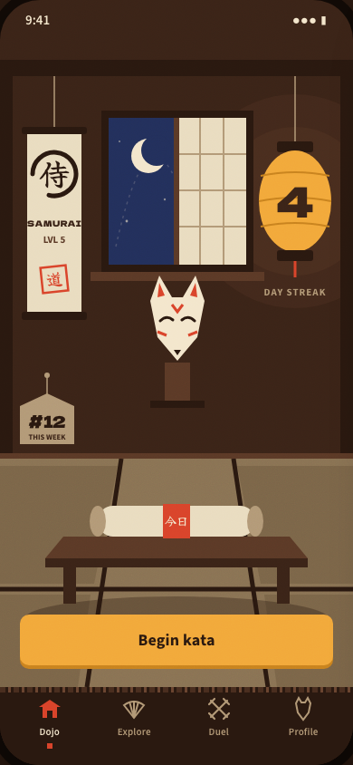
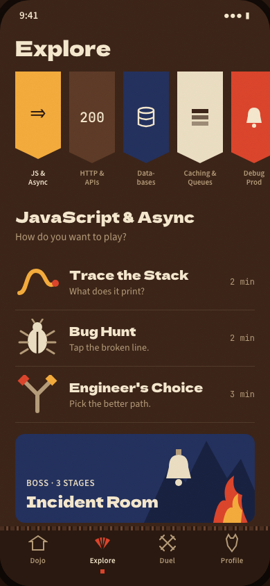
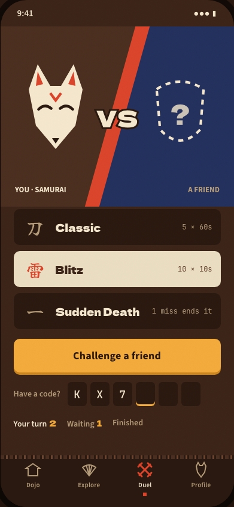
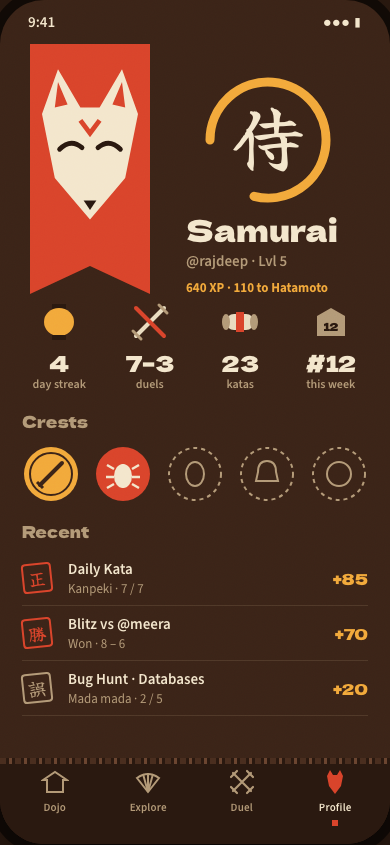
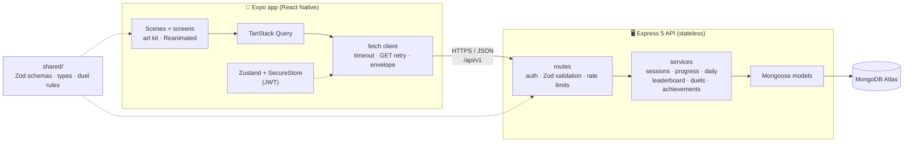
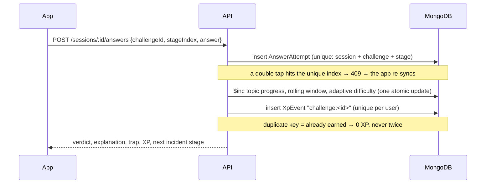

<div align="center">



# Luna 月

### The samurai of code.

**A pocket dojo for engineers.** Five-minute fights with real code: predict what it prints, slay the
buggy line, pick the better trade-off, and survive a production incident. Climb from _Deshi 弟子_ to
_Shogun 将軍_, keep the lantern lit, and duel your friends.


[The dojo](#道-the-idea) · [Play](#遊-how-you-play) · [Duels](#刀-duels) · [Ranks](#侍-ranks-and-progress) ·
[Design](#紙-the-look-kiri-e-den) · [Architecture](#築-how-it-works) · [Install the APK](#install-the-apk-android) ·
[Run it](#始-run-it-yourself) ·
[API](#api-reference) · [Engineering](#守-engineering-notes) · [Docs](#書-documentation)

<table>
  <tr>
    <td align="center"><br /><sub><b>Dojo</b> · the room is the menu</sub></td>
    <td align="center"><br /><sub><b>Explore</b> · pick a banner, pick a game</sub></td>
    <td align="center"><br /><sub><b>Duel</b> · choose your blade</sub></td>
    <td align="center"><br /><sub><b>Profile</b> · the warrior sheet</sub></td>
  </tr>
</table>

<sub>Screens from the approved Kiri-e Den design reference (<a href="docs/design/kirie-preview.html"><code>docs/design/kirie-preview.html</code></a>), which the app is built to match.</sub>

</div>

---

## 道 The idea

It's 11 pm. You've shipped code all day, and your thumb is drifting towards reels. Luna is the other
thing you could open: a quiet, lamplit dojo where the master rests after work and plays a few rounds of
engineering judgement. It feels like a game, not homework, and you still walk away a little sharper.

CS students and early-career engineers meet the event loop, SQL indexes and cache invalidation in a
dozen courses, but rarely practise _applying_ them. Videos are passive, and LeetCode-style problems need
an hour. Luna fits engineering judgement into five minutes, such as _"which line is the bug?"_ or
_"p99 just spiked after a deploy: what do you check first?"_, and explains every answer.

|                  |                                                                                                       |
| ---------------- | ----------------------------------------------------------------------------------------------------- |
| **Who it's for** | CS students (18–24) first; early-career developers keeping their fundamentals sharp second            |
| **A session**    | 2–6 minutes. A mode round is 5 questions; the Daily Kata is 5 challenges (7 answers)                  |
| **The loop**     | Open the dojo → play today's kata → stamp → XP → rank up → duel a friend → come back tomorrow         |
| **The feel**     | Cut-paper Japanese den at night: lantern amber, vermilion seals, brush kanji, everything is an object |

---

## 遊 How you play

### The Dojo is the home screen

There's no dashboard. Home is a room, and **the objects in it are the buttons**:

| Object                 | It is…                                                      | Tap it to…                              |
| ---------------------- | ----------------------------------------------------------- | --------------------------------------- |
| 🏮 Paper lantern       | Your streak: lit when today's kata is done, out when broken | See your profile                        |
| 📜 Hanging rank scroll | Your rank kanji, with an ensō that closes as XP fills       | See your profile                        |
| 📜 Sealed kata scroll  | Today's Daily Kata, on the low table                        | Break the seal and play                 |
| 🪧 Ema plaque          | Your place on this week's Dojo Board                        | Open the board                          |
| ✉️ Letter              | Appears under the shoji when a Checkpoint is ready          | Take the Checkpoint                     |
| 👺 Resting mask        | You: the yokai mask you picked                              | See your profile                        |
| 🌙 Moon                | Moves across the window through the day                     | (Just look: it's the time to the reset) |

Every time you return to the room, it comes alive: the scroll unrolls, the lantern drops on its cord and
swings, the ema sways, and the mask rises onto its stand.

### Four ways to fight

| Mode                  | What you do                                                                                                    | Example                                            |
| --------------------- | -------------------------------------------------------------------------------------------------------------- | -------------------------------------------------- |
| **Trace the Stack**   | Predict the output of code, a query or an HTTP exchange                                                        | `setTimeout` vs `Promise.then`: which logs first?  |
| **Bug Hunt**          | Tap the line that holds the bug                                                                                | The `forEach(async …)` that never awaits           |
| **Engineer's Choice** | Pick the better option in a scenario; every wrong option explains why it's worse                               | Cache-aside vs write-through for a read-heavy feed |
| **Incident Room**     | The boss fight: a 3-stage investigation (alert → investigation → resolution); each answer reveals new evidence | p99 latency spike after a deploy                   |

**Explore** shows the five topics as hanging nobori banners: JavaScript & Async, HTTP & APIs, Databases,
Caching & Queues, and Debugging & Production. Pick a banner, then pick how to play: a Trace round, a Bug
Hunt round, an Engineer's Choice round, or that topic's **boss incident**. A mode round is five
questions of that kind from the topic, topped up from other topics when the topic runs thin.

### Every answer is a strike

<p align="center">
  
</p>

- **Right:** an ink slash cuts across the screen, **見事** (_migoto_, "splendid") is brushed in, a red
  **正** seal strikes, and the XP counts up. There's no lecture, but _Why it works_ is one tap away.
- **Wrong:** a grey **誤** seal, then a sheet of shoji paper with the right answer, the explanation, the
  common trap and why the other options are worse.
- **End of round:** a grade seal (_Kanpeki · Sugoi · Yoshi · Mada mada_), the XP count-up, the lantern
  relighting if the streak grew, and your weak topics as _Train again_ buttons.

The question bank holds **58 hand-written items** (13 Trace, 13 Bug Hunt, 24 Engineer's Choice and
8 Incident Rooms) across 5 topics × 3 difficulties. Each one is validated against a schema when it's
seeded.

---

## 刀 Duels

Asynchronous friend duels: nobody needs to be online at the same time. You create a duel, share a
6-character code (`KX7P2M`, with no ambiguous `0/O/1/I`), and your friend types it into six cells. You
both play the **same questions in the same option order**. Choose your blade:

| Blade            | Kanji | Rules                                                        |
| ---------------- | :---: | ------------------------------------------------------------ |
| **Classic**      |  刀   | 5 questions × 60 s                                           |
| **Blitz**        |  雷   | 10 questions × 10 s                                          |
| **Sudden Death** |  一   | Up to 10 questions × 30 s. **Your first miss ends the run.** |

Most correct wins, then the lower total time (compared in whole seconds), else a draw. There are no
hints. Duels expire after 48 h, and a no-show loses by default. A win pays **+10 XP**, at most 3 times a
day. The result is a face-off: both masks slide in and clash, the winner gets the **勝** seal, and each
answer is stamped 正 or 誤.

---

## 侍 Ranks and progress

| Lvl | Rank         | Kanji |  XP |     | Lvl | Rank         | Kanji |    XP |
| --: | ------------ | :---: | --: | --- | --: | ------------ | :---: | ----: |
|   1 | **Deshi**    | 弟子  |   0 |     |   6 | **Hatamoto** | 旗本  |   750 |
|   2 | **Ashigaru** | 足軽  |  50 |     |   7 | **Kenshi**   | 剣士  | 1 050 |
|   3 | **Ronin**    | 浪人  | 150 |     |   8 | **Sensei**   | 先生  | 1 400 |
|   4 | **Bushi**    | 武士  | 300 |     |   9 | **Daimyo**   | 大名  | 1 800 |
|   5 | **Samurai**  |  侍   | 500 |     |  10 | **Shogun**   | 将軍  | 2 300 |

Ranking up stops everything: a katana draws across the screen, then your new kanji is brushed in inside
a closing ensō.

- **XP:** 10 / 15 / 20 for a _first_ correct answer, by difficulty. A hint halves it. Repeats inside the
  Kata earn 2 XP of review. There are bonuses for finishing the Kata, a perfect Kata, your first incident,
  duel wins and streak milestones (3 / 7 / 30 days).
- **Streak, the lantern:** stays lit while you finish a Kata every calendar day in _your_ time zone.
- **Daily Kata:** one per player per day: 1 Trace, 1 Bug Hunt, 2 Engineer's Choice and 1 Incident. It
  favours unseen questions at your level, leans towards your weak topics, and mixes in up to 2 you
  missed before. Reopening it gives the same set.
- **Adaptive difficulty:** per topic, 4–5 correct of the last 5 moves you up, and 2 or fewer moves you
  down.
- **Mistake revisits:** a missed question comes back after at least 3 other answers.
- **Baseline and Checkpoint:** an optional 5-question baseline sets your starting level. Every 7 Katas, a
  letter arrives with a Checkpoint of 5 unseen questions that shows how far you've come.
- **Dojo Board:** a weekly XP leaderboard (so a newcomer can top it) that resets Monday 00:00 UTC. Last
  week's top 3 wear medals, and your own row is always pinned.
- **Crests:** _First Strike · Bug Slayer · Seven Katas · Incident Commander · Kanpeki_. Each is earned
  once. Locked crests show as dashed outlines with their condition.
- **Profile, the warrior sheet:** your mask on a banner, the rank kanji in its ensō, and four trophies:
  streak, duel record, katas, and weekly place. Below that are your crests and recent runs, stamped like a
  scroll.

---

## 紙 The look: Kiri-e Den

Luna's design system is **Kiri-e Den** ("cut-paper den"), defined in [`DESIGN.md`](DESIGN.md), with a
clickable reference in [`docs/design/kirie-preview.html`](docs/design/kirie-preview.html).

- **Flat cut-paper scenes**, drawn as `react-native-svg` components on one 390-wide grid that scales to
  any phone. There are no cards and no progress bars: progress is an ensō or brush marks.
- **One action colour.** Lantern amber `#F2A93B` means "go". Vermilion `#D9442B` is for seals and shapes
  only, never for text. Kakishibu brown `#3B2418` is the ground, and washi `#F3E6CC` is the text (11.7:1).
- **Three voices:** _Dela Gothic One_ for the game (titles, numbers, ranks), _Source Sans 3_ for reading,
  _JetBrains Mono_ for code.
- **Brush kanji without shipping a brush font.** A dev-only script reads the Yuji Boku font and bakes the
  ~30 glyphs Luna uses into typed SVG path data. The app never carries the 8.6 MB font.
- **Authored motion:** coming home (the shoji slide apart), the hanko strike, the lantern relight, the
  rank-up katana, the duel clash, the room's entrance and the correct-answer cut. Every one has a Reduce
  Motion fallback, and haptics stay on.
- **Accessible by default:** every scene object has a role and label (_"Streak: 4 days. Lantern."_),
  Dynamic Type works up to 1.3×, touch targets are at least 44 pt, and every press sinks 2 pt with a
  haptic, with no grey ripple anywhere.

---

## 築 How it works



- **Thin client, authoritative server.** The app draws the dojo and collects taps. Evaluation, XP,
  streaks, mastery, difficulty, rankings, duel timers and results all happen on the server.
- **One contract.** `shared/` holds the Zod schemas, the TypeScript types and the duel format rules. The
  API validates with them and the app is typed against them, so a breaking change fails `tsc` on both
  sides.
- **The server holds the position.** A session is stored answer by answer, so closing the app mid-kata
  and reopening it resumes on the exact question.

### Answering a question



---

## Tech stack

| Layer        | Choice                                            | Why                                                                            |
| ------------ | ------------------------------------------------- | ------------------------------------------------------------------------------ |
| App          | **Expo SDK 58**, React Native 0.88, TypeScript    | One codebase for iOS and Android, played on a real phone through Expo Go       |
| Art & motion | react-native-svg, **Reanimated 4**, expo-haptics  | Cut-paper scenes as components; animated SVG props; every press is felt        |
| Navigation   | React Navigation 7 (native stack, custom tab bar) | Typed route params; a hand-drawn tab bar with hanko marks                      |
| Server state | TanStack Query 5                                  | Caching, refetch on focus, infinite lists                                      |
| Client state | Zustand + expo-secure-store                       | Tiny stores; the JWT lives in the OS keychain                                  |
| API          | **Node 20, Express 5**, TypeScript                | Async errors handled natively, small surface                                   |
| Validation   | **Zod 4** (shared package)                        | One schema per request, used by both server and app                            |
| Database     | **MongoDB Atlas** + Mongoose 9                    | Flexible challenge documents; unique and partial indexes do the integrity work |
| Auth         | JWT (HS256, 7 days) + bcrypt (cost 12)            | Stateless and simple for a mobile client                                       |
| Security     | helmet, CORS allow-list, express-rate-limit       | Baseline hardening, plus per-account login lockout                             |
| Logging      | pino + pino-http                                  | Structured JSON logs; secrets and answer keys redacted                         |
| Tests        | Vitest, Supertest, mongodb-memory-server          | Real HTTP against a real in-memory MongoDB                                     |
| Tooling      | npm workspaces, ESLint, Prettier, `tsc --noEmit`  | No extra monorepo tool                                                         |

---

## Install the APK (Android)

The quickest way to play. No Expo Go, no setup: the APK talks to the live API on Render.

1. On your Android phone, open the [**v1.0.0 release**](https://github.com/rajdeep-2004/luna/releases/tag/v1.0.0)
   and download [`luna-v1.0.0.apk`](https://github.com/rajdeep-2004/luna/releases/download/v1.0.0/luna-v1.0.0.apk).
2. Open the file. Android asks you to allow installs from this source (your browser or file manager):
   allow it, then tap **Install**. The APK is signed, but it doesn't come from the Play Store, so
   Android shows this prompt once.
3. Open **Luna** and register. The first open after a quiet spell can take up to a minute while the
   free Render server wakes up; the app says so instead of hanging.

The APK is built by [EAS Build](https://docs.expo.dev/build/introduction/) from the `apk` profile in
[`app/eas.json`](app/eas.json), with the production API URL built in. iOS has no installable build in V1:
use Expo Go (below).

## 始 Run it yourself

### Prerequisites

- **Node.js 20+** and npm 10+
- A **MongoDB** connection string: a free [Atlas M0](https://www.mongodb.com/atlas) cluster, or a local
  `mongod`
- **Expo Go** on your phone (iOS or Android), on the same Wi-Fi network as your computer

### 1. Install

```bash
git clone https://github.com/rajdeep-2004/luna.git
cd luna
npm install            # installs shared, server and app (npm workspaces)
```

### 2. Configure

```bash
cp server/.env.example server/.env
cp app/.env.example app/.env
```

Fill in `server/.env`:

```bash
MONGODB_URI=mongodb+srv://<user>:<password>@<cluster>.mongodb.net/luna_dev
JWT_SECRET=$(node -e "console.log(require('crypto').randomBytes(48).toString('base64url'))")
```

In `app/.env`, point the app at your computer's **LAN IP**, not `localhost` (on the phone, `localhost`
is the phone itself), or at the live API:

```bash
EXPO_PUBLIC_API_URL=http://192.168.1.5:8080/api/v1      # macOS: ipconfig getifaddr en0
# EXPO_PUBLIC_API_URL=https://luna-kloi.onrender.com/api/v1
```

### 3. Seed the question bank

```bash
npm run seed -w server
```

The seed validates every challenge against the content schema, upserts the topics and challenges, and
**syncs every collection's indexes**. Re-run it after pulling schema changes; it is safe to run again.

### 4. Enter the dojo

```bash
npm run dev -w server     # API on http://localhost:8080 (tsx watch)
npm run start -w app      # Expo dev server: scan the QR code with Expo Go
```

Check the API with `curl http://localhost:8080/api/v1/health` → `{"data":{"status":"ok","db":true}}`.

### Scripts

| Command                           | What it does                                                              |
| --------------------------------- | ------------------------------------------------------------------------- |
| `npm run dev -w server`           | API with hot reload, reading `server/.env`                                |
| `npm run seed -w server`          | Load the question bank and sync indexes                                   |
| `npm run build -w server`         | Bundle the API and seed script to `server/dist/` (tsup)                   |
| `npm run start -w server`         | Run the built API                                                         |
| `npm run start -w app`            | Expo dev server                                                           |
| `node app/scripts/bake-kanji.mjs` | Re-bake brush kanji into `app/src/art/kanjiPaths.ts` after adding a glyph |
| `npm run lint`                    | ESLint across the repo                                                    |
| `npm run typecheck`               | `tsc --noEmit` in every workspace                                         |
| `npm run format`                  | Prettier                                                                  |

---

## 🎬 Demo script (5 minutes, two phones)

A walk-through that touches every V1 feature. Use two accounts: **A** on one phone and **B** on the
other.

1. **Welcome (A).** The shoji slide open on a lit lantern. _Enter the dojo_ → register → pick a mask
   from the wooden rack → topics → level → take the 5-question baseline.
2. **The Dojo.** Point out that the room is the UI: lantern = streak, scroll = rank with its ensō,
   ema = weekly place. Leave the tab and come back to watch the room's entrance.
3. **Daily Kata.** Tap the sealed scroll. Answer one right (the ink slash, 見事 and the 正 seal), then
   tap _Why it works_. Answer one wrong (誤 and the shoji sheet with the right answer and the trap).
   Play the incident stage by stage.
4. **Summary.** The grade seal, the XP count-up and the lantern relighting (day 1). If you cross 50 XP,
   the rank-up katana plays: Deshi → Ashigaru.
5. **Explore.** Tap the _Databases_ banner → _Bug Hunt_ round. Show the boss stage: Incident Room.
6. **Duel.** On A: pick **Sudden Death** → _Challenge a friend_ → share the code. On B: type the code
   into the six cells → play until the first miss (_"Run over"_). On A: play. Open the result: the
   masks clash, the 勝 seal goes to the winner, and each answer is stamped.
7. **Dojo Board.** Tap the ema: both players are ranked by this week's XP, and your own row is on shoji.
8. **Profile.** The banner and rank kanji, the four trophies (now including a duel record), a crest
   earned (_First Strike_), and recent runs stamped.
9. **Resilience.** Kill the app mid-round and reopen it: it resumes on the same question. Turn on
   airplane mode: you see an error with _Try again_ instead of a crash.

---

## Configuration

Every variable is documented in the `.env.example` files. Only `server/src/config` reads `process.env`
on the server, and only `app/src/config/env.ts` reads it in the app. The server validates its
environment with Zod at startup and refuses to boot when something is missing.

| Variable              | Where  | Required | Default  | Purpose                                                    |
| --------------------- | ------ | :------: | -------- | ---------------------------------------------------------- |
| `NODE_ENV`            | server |    ✓     | —        | `development`, `test` or `production`                      |
| `PORT`                | server |          | `8080`   | API port                                                   |
| `MONGODB_URI`         | server |    ✓     | —        | MongoDB connection string                                  |
| `JWT_SECRET`          | server |    ✓     | —        | HS256 signing secret, at least 32 characters               |
| `JWT_EXPIRES_IN`      | server |          | `7d`     | Token lifetime                                             |
| `CORS_ORIGINS`        | server |          | _(none)_ | Comma-separated allowed origins (only Expo web needs this) |
| `LOG_LEVEL`           | server |          | `info`   | pino log level                                             |
| `EXPO_PUBLIC_API_URL` | app    |    ✓     | —        | API base URL including `/api/v1`                           |

**Game rules are data.** Every number in the game (the XP table, bonuses and caps, rank thresholds,
mastery and adaptivity windows, Kata composition, duel slots, expiry and limits) lives in
[`server/src/config/game.ts`](server/src/config/game.ts). The duel formats' sizes and timers live in
[`shared/src/competition.ts`](shared/src/competition.ts) (`DUEL_FORMAT_RULES`), so the app's countdown
and the server's clock read the same numbers. Auth and rate limits live in
[`server/src/config/security.ts`](server/src/config/security.ts).

---

## Project structure

```
luna/
├── app/                      Expo app: draws the dojo, holds no game rules
│   ├── scripts/              bake-kanji.mjs (dev-only: font glyphs → SVG paths)
│   └── src/
│       ├── art/              cut-paper art kit: DojoScene, Lantern, RankScroll, Enso, KataScroll,
│       │                     EmaPlaque, YokaiMask, HankoStamp, TopicBanner, ModeArt, FaceOff, Crest…
│       ├── screens/          auth · onboarding · dojo · explore · game · duel · board · profile
│       ├── components/       interaction kit: PressableSink, Button, OptionRow, CodeBlock, CodeCells…
│       ├── navigation/       Root → Auth / Onboarding / App stack → custom tab bar
│       ├── api/              fetch client, endpoints, query client
│       ├── store/            auth, onboarding, dojo moments, connection (Zustand)
│       ├── lib/ · theme/ · config/
├── server/                   Express API
│   └── src/
│       ├── modules/          auth · users · topics · challenges · sessions · progress · daily
│       │                     leaderboard · duels · achievements · health
│       │                     (each: *.routes.ts → *.service.ts, plus focused helpers)
│       ├── models/           Mongoose schemas and indexes
│       ├── config/           env (Zod), game rules, security
│       ├── middleware/       requireAuth, validate, rateLimit, errorHandler
│       ├── lib/ · db/
│       └── seed/             question bank + content schema
├── shared/                   Zod schemas, types and duel rules: the API contract
├── docs/                     PRD, architecture, decisions, game design, design preview, V1 audit
└── DESIGN.md                 the Kiri-e Den design system
```

The server is layered **routes → services → models**. Route handlers only authenticate, validate and
call one service. Services hold the rules and never touch `req`/`res`.

---

## API reference

Base URL `/api/v1`. Every endpoint except health, register and login needs
`Authorization: Bearer <token>`.

**Envelope.** Success is `{ "data": … }`. Errors are `{ "error": { "code", "message", "details"? } }`
with codes `VALIDATION_ERROR` 400 · `UNAUTHORIZED` 401 · `NOT_FOUND` 404 · `CONFLICT` 409 ·
`RATE_LIMITED` 429 · `INTERNAL` 500 · `DB_UNAVAILABLE` 503. Error responses never include stack traces.

| Method          | Endpoint                         | Purpose                                                                                                         |
| --------------- | -------------------------------- | --------------------------------------------------------------------------------------------------------------- |
| `GET`           | `/health`                        | Liveness and DB ping                                                                                            |
| `POST`          | `/auth/register` · `/auth/login` | Create an account or log in → token + user (rate-limited, account lockout)                                      |
| `GET` · `PATCH` | `/users/me`                      | Profile; onboarding fields (mask, topics, level, timezone)                                                      |
| `GET`           | `/users/me/progress`             | Rank, streak, topic mastery, assessments, and `stats` (katas, duels won / lost / drawn)                         |
| `GET`           | `/users/me/sessions`             | Run history (keyset cursor)                                                                                     |
| `GET`           | `/users/me/achievements`         | All five crests, earned and locked                                                                              |
| `GET`           | `/topics`                        | The five topics                                                                                                 |
| `POST`          | `/sessions`                      | Start or resume: `PRACTICE {topicSlug, mode?}`, `INCIDENT {topicSlug?, challengeId?}`, `BASELINE`, `CHECKPOINT` |
| `GET`           | `/sessions/:id`                  | Resume a session (no answer keys, ever; duels carry `duelFormat` and a server-measured `stepElapsedMs`)         |
| `POST`          | `/sessions/:id/answers`          | Submit an answer → verdict, explanation, XP, next stage                                                         |
| `POST`          | `/sessions/:id/hint`             | Reveal the hint (halves that answer's XP; none in duels)                                                        |
| `POST`          | `/sessions/:id/complete`         | Finish → summary with bonuses, streak, rank-up, new crests (idempotent)                                         |
| `GET`           | `/daily`                         | Today's Daily Kata (built once per player per local day)                                                        |
| `GET`           | `/leaderboard/weekly`            | `?cursor&limit` weekly ranking + your own row                                                                   |
| `GET` · `POST`  | `/duels`                         | Your duel lists · create a duel `{ format?: CLASSIC \| BLITZ \| SUDDEN_DEATH }`                                 |
| `POST`          | `/duels/join`                    | `{ code }` → join (atomic, rate-limited)                                                                        |
| `GET`           | `/duels/:id`                     | Status, and the result with the per-question breakdown (participants only)                                      |
| `POST`          | `/duels/:id/play`                | Start or resume your duel session                                                                               |

---

## 守 Engineering notes

The parts that make the game hard to cheat or break.

### Integrity by construction

- **Answer keys never leave the server.** Challenges go out through one public projection, and tests
  assert that no response contains `answerKey`, `explanation` or `rootCause` before you answer.
- **XP is a ledger.** Every award is a row with a unique `sourceKey` (`challenge:<id>`, `daily:<date>`,
  `streak7:<runStart>`…). "First correct only" and "bonus once" are enforced by a unique index, not by
  `if` statements, so a retry or a double tap can never pay twice.
- **Idempotent writes everywhere.** A double-submitted answer hits a unique index and gets a 409, which
  the app treats as "already answered". Completing a session is a conditional `ACTIVE → COMPLETED`
  update. Partial unique indexes make two simultaneous "Start" taps one session, and two first opens of
  the day one Kata.
- **Time is the server's.** Answer times are measured on the server. Streaks use the player's local
  calendar day, compared as date strings, so a time-zone change can't farm a streak.

### Duels without race conditions

- **One opponent, guaranteed.** Joining is a single conditional update (`OPEN`, no opponent, not the
  creator, not expired), so exactly one person wins a race for one code.
- **A timer the client can't pause.** The on-screen countdown is only a display. The server marks any
  answer later than the format's timer plus its grace (5 s, or 2 s for Blitz) as a timeout and records
  exactly the timer. A resumed duel shows the real time left, measured on the server.
- **Sudden Death that can't be gamed.** Answers must come in order. The first miss ends the run, and the
  score counts only the run up to that miss, even if a concurrent request slipped in. "Run over" is
  derived from the saved answers as well as a flag, so a crash between the two can't strand a run.
- **Lazy, guarded expiry.** There's no cron. Every read of a duel settles it if it's due, and each
  transition is a compare-and-set, so a late finish never flips a result.
- **A daily cap the database enforces.** The 3-wins-a-day bonus uses three ledger slots per day
  (`duelwin:<date>:1..3`).

### Security

- bcrypt (cost 12) with a 72-byte password limit. Per-IP rate limits on auth and duel join, and
  per-account lockout after 5 failed logins.
- Authorisation per resource: every session, attempt and progress query is scoped to the caller. Duels
  return 404 to anyone but the two players, so ids don't leak.
- Zod validation at every boundary (body, params, query). ObjectId params are checked before a query.
- helmet headers, a CORS allow-list, a 100 kB body limit, no stack traces, and pino redaction of
  credentials.

### Performance and scale

- The server is stateless (JWT, nothing in memory), so it scales horizontally.
- Every list is bounded and paginated, indexes match the access patterns, and duel lists batch their
  reads (no N+1). Profile stats are four indexed counts, with no counters to drift.
- **First bottleneck:** the Dojo Board aggregates the week's ledger per request. That's fine at this
  scale; the next step is a cached weekly counter (`TODOS.md`).
- **Cold starts:** the free Render instance sleeps when idle. After 4 s the app shows _"Waking the
  dojo…"_ with a breathing lantern, times out each request at 15 s, and retries GETs (never POSTs) with
  backoff.
- **Small art budget:** scenes are static SVG paths with a few animated transforms, and the brush kanji
  are baked paths instead of an 8.6 MB font.

---

## Testing

| Layer           | What                                                                                                                                                                                                                                                                                                                                                                           | How                                        |
| --------------- | ------------------------------------------------------------------------------------------------------------------------------------------------------------------------------------------------------------------------------------------------------------------------------------------------------------------------------------------------------------------------------ | ------------------------------------------ |
| API smoke tests | **66 tests** over real HTTP against an in-memory MongoDB: auth and lockout, answer-key leakage, double submits, XP once, streak rules, Daily Kata once under concurrency, mastery and adaptivity, revisits, the board, crests, mode rounds and boss incidents, the duel join race, timers per format, Sudden Death (including crash recovery), tie-break, expiry and bonus cap | Vitest + Supertest + mongodb-memory-server |
| Static          | Lint and a strict typecheck of all three workspaces                                                                                                                                                                                                                                                                                                                            | `npm run lint && npm run typecheck`        |
| App             | A click-through checklist per phase on a real phone, judged for feel against the design preview                                                                                                                                                                                                                                                                                | Manual, in Expo Go                         |

> The API suite lives in `.scratch/api-tests/`, which is **intentionally gitignored** (D-002, D-005):
> the pushed repo holds product code only, and the suite runs locally before every commit with
> `cd .scratch/api-tests && npx vitest run`.

The latest end-to-end check of V1 against its acceptance criteria is in
[`docs/v1-audit.md`](docs/v1-audit.md).

---

## Deployment

**Live.** The API runs at `https://luna-kloi.onrender.com/api/v1` (health: `/api/v1/health`).

- **API:** a Render web service rooted at the repo root (the server depends on the `shared` workspace),
  built with `npm ci --include=dev && npm run build -w server`, started with `npm run start -w server`,
  health check `/api/v1/health`. It auto-deploys from `main`.
- **Database:** MongoDB Atlas M0, with separate `luna_dev` and `luna_prod` databases.
- **After a deploy that changes indexes,** run the seed once against production so `syncIndexes`
  applies them: `MONGODB_URI=<production URI> npm run seed -w server`.
- **App:** an Android APK built by EAS Build (`apk` profile in `app/eas.json`, pointed at the Render URL)
  and attached to the [v1.0.0 GitHub Release](https://github.com/rajdeep-2004/luna/releases/tag/v1.0.0).
  In development, Expo Go with `EXPO_PUBLIC_API_URL` set to your LAN IP. There are no Play Store or App
  Store builds in V1.

---

## 書 Documentation

The repo is the source of truth, and everything below is written to be read.

| Document                                                           | What's inside                                                                        |
| ------------------------------------------------------------------ | ------------------------------------------------------------------------------------ |
| [`DESIGN.md`](DESIGN.md)                                           | Kiri-e Den: palette, type, layout, components, the authored motions                  |
| [`docs/design/kirie-preview.html`](docs/design/kirie-preview.html) | The approved visual reference (open it in a browser)                                 |
| [`docs/prd.md`](docs/prd.md)                                       | Problem, users, goals, non-goals, features with acceptance criteria, metrics, phases |
| [`docs/product/`](docs/product/README.md)                          | Game design: players, modes, scoring, progression, competition, benchmarks           |
| [`docs/architecture.md`](docs/architecture.md)                     | Delivery setup, stack, layout, data model, key flows and failure handling            |
| [`docs/decisions.md`](docs/decisions.md)                           | Every product and technical decision (D-001 → D-043): context, options rejected, why |
| [`docs/build-plan.md`](docs/build-plan.md)                         | Phase task lists and the API surface                                                 |
| [`docs/v1-audit.md`](docs/v1-audit.md)                             | V1 checked against its 12 acceptance criteria, with evidence and open items          |
| [`TODOS.md`](TODOS.md)                                             | Backlog, deferred ideas and known debt                                               |

### Product decisions worth a look

- **A game, not a study app (D-037).** The first UI was correct but read like a report card, so P7
  rebuilt it as a place: the room is the menu, every answer is a strike, and topic statistics left the
  screen (the server still uses them to pick your questions).
- **Two measures that never mix.** Rank shows effort (XP), and mastery shows skill (accuracy), so
  grinding easy questions can't fake skill.
- **A weekly board, not all-time,** so a newcomer can win. Leagues were cut because they feel empty
  below about 30 active players per group.
- **Asynchronous duels with blades.** Friends don't need to be online together, and Blitz and Sudden
  Death give the same questions a different tension. A default win pays no bonus, so an idle second
  account can't farm it.
- **Explanations on demand.** A miss always shows why. A hit celebrates first, and the reason is one tap
  away.

---

## Roadmap

| Status | Phase                                                                                    |
| :----: | ---------------------------------------------------------------------------------------- |
|   ✅   | **P0** Product design and plan                                                           |
|   ✅   | **P1** Backend core: auth, content, challenge engine                                     |
|   ✅   | **P2** App foundation, auth and onboarding                                               |
|   ✅   | **P3** Game UI: four modes, feedback, summary, Explore                                   |
|   ✅   | **P4** Progression: XP, ranks, streaks, Daily Kata, adaptivity, Checkpoint               |
|   ✅   | **P5** Competition and profile: Dojo Board, duels, achievements, history                 |
|   🔨   | **P6** Polish, deploy and demo prep: deployed; network pass and acceptance run remaining |
|   ✅   | **P7** Game redesign: Kiri-e Den, the Dojo room, mode rounds, Blitz and Sudden Death     |
|   ⏳   | **P8** New mini-games for Explore                                                        |

**After V1:** a bigger question bank (the first priority), a streak freeze, public duel matchmaking, and
leagues once there are enough players. Real-time duels, an AI sparring partner and new tracks (DSA,
DevOps, system design) are parked in [`TODOS.md`](TODOS.md).

---

<div align="center">

**Luna 月** · built as a university capstone by **Rajdeep**.
A product exercise as much as an engineering one: every feature traces back to a user problem in the PRD.

_Bow in. Keep the lantern lit._

</div>
