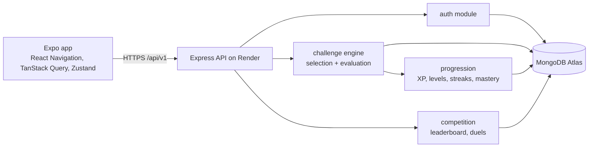

# Architecture — Luna

> Last updated: 2026-11-22 — Written at planning time (P0). Update whenever the build diverges.

## 0. Delivery setup

Confirmed in chat on 2026-11-22 (see `decisions.md` D-002, D-005, D-006).

- **Testing:** backend API tests only. Vitest + Supertest + mongodb-memory-server. The tests live in
  `.scratch/api-tests/`, which is **gitignored and never pushed**. There is no TDD requirement and
  no coverage target. The frontend is tested by hand (Rajdeep, using a checklist).
- **Deployment:** backend on **Render** (free web service), database on **MongoDB Atlas** (free M0).
  The mobile app runs through **Expo Go**. No store builds.
- **Docker:** none.
- **CI:** none. **CD:** Render's git integration auto-deploys `server/` from `main`.
- **Always on, locally, before every commit:** ESLint + `tsc --noEmit` for every workspace.
  `.env` is gitignored, and `.env.example` documents every variable.
- **Git flow:** one branch per phase (`phase/p<n>-<slug>`). When the phase is done, merge it into `main`
  and push. **No pull requests.** Backend phases get one backend code review before the merge.

> UI design system: `docs/product/ui-design.md` (approved). Game rules: `docs/product/`.

## 1. Overview

An Expo (React Native, TypeScript) app talks over HTTPS/JSON to a stateless Express API
(TypeScript), which stores everything in MongoDB Atlas through Mongoose. The server owns all game
logic: it chooses challenges, hides answer keys, evaluates answers, awards XP, updates streaks and
topic progress, ranks the leaderboard and settles duels. The app is a thin client that renders
challenge data and shows results. A small `shared/` package holds the Zod schemas and TypeScript
types for the API contract, so the app and the server can't drift apart.

## 2. Component diagram



## 3. Tech stack

| Layer | Choice | Why |
|---|---|---|
| Mobile | Expo (latest stable SDK), React Native, TypeScript | Course requirement. Expo Go means no native build setup (D-003) |
| Navigation | **React Navigation** (native stack + bottom tabs), not Expo Router | Chosen by Rajdeep (D-003) |
| Server state | TanStack Query | Caching, retries, loading and error states (D-003) |
| Client state | Zustand | Auth token and in-progress session UI state only (D-003) |
| Token storage | expo-secure-store | Keychain/Keystore, not plain AsyncStorage (D-003) |
| Backend | Node.js (LTS), Express 5, TypeScript | From the brainstorm. Express 5 forwards async errors (D-003) |
| Validation | Zod, shared between app and server | One schema validates on the server and types on the client (D-004) |
| Database | MongoDB Atlas + Mongoose | From the brainstorm (D-003). No multi-document transactions (D-015) |
| Auth | JWT (HS256) + bcrypt | From the brainstorm (D-008) |
| Security middleware | helmet, cors, express-rate-limit | Engineering baseline |
| Logging | pino + pino-http | Structured JSON logs, cheap |
| API tests | Vitest, Supertest, mongodb-memory-server | Smoke tests in gitignored `.scratch/` (D-005, D-015) |
| Hosting | Render + Atlas M0 | Free, auto-deploy from `main` (D-006) |
| Package manager | npm workspaces | No extra tool. Expo supports npm monorepos (D-004) |

## 4. Codebase layout

```
luna/
├── app/                    Expo app (React Native). UI only, no business rules
│   ├── src/navigation/     RootNavigator, AuthStack, MainTabs, typed route params
│   ├── src/screens/        one folder per screen (auth, onboarding, home, explore, game, summary, leaderboard, duel, profile)
│   ├── src/features/game/  challenge renderer + one component per challenge type
│   ├── src/api/            fetch client (timeout, retry, envelope parsing) + TanStack Query hooks
│   ├── src/store/          Zustand stores (auth, active session)
│   ├── src/components/     shared UI (Button, Card, ErrorState, Loading...)
│   └── src/theme/          colours, spacing, typography
├── server/                 Express API
│   ├── src/config/         env parsing (Zod). The only place that reads process.env
│   ├── src/modules/<name>/ routes → controller → service → repository, per feature:
│   │                       auth, users, topics, challenges, sessions, progress, daily,
│   │                       leaderboard, duels, achievements
│   ├── src/models/         Mongoose schemas + indexes
│   ├── src/middleware/     auth, validate, rateLimit, errorHandler, requestId
│   ├── src/lib/            logger, errors, time (timezone/week helpers), codes
│   └── src/seed/           seed script + content/*.ts (the question bank)
├── shared/                 Zod schemas + TS types for API requests and responses (no runtime deps besides zod)
├── docs/                   prd, architecture, build-plan, decisions, luna-idea (brainstorm)
├── .scratch/               GITIGNORED. API tests and throwaway scripts, never pushed
└── package.json            npm workspaces: app, server, shared
```

## 5. Modules and responsibilities (server)

| Module | Owns | Depends on | Must not |
|---|---|---|---|
| auth | register, login, JWT issue/verify, password hashing | users repo | return passwordHash |
| users | profile, onboarding fields, `/users/me` | — | change XP or streak directly |
| topics | topic list | — | — |
| challenges | challenge repo, public projection (no answer key) | — | send `answerKey` / `stages[].answerKey` |
| sessions | start session, submit answer, complete session | challenges, progress, daily, achievements | trust client time or correctness |
| progress | XP ledger, levels, streaks, topic progress, mastery, adaptivity | — | award XP twice for the same source |
| daily | build or return today's Daily Kata per user | challenges, progress | build two circuits for the same user and day |
| leaderboard | weekly ranking aggregation | progress (XP ledger) | scan unbounded results |
| duels | create, join, result | sessions | let a user join their own duel |
| achievements | evaluate and award badges after session events | progress | award the same badge twice |

## 6. Layering rules

`routes` (path + middleware) → `controller` (parse validated input, call a service, send the envelope)
→ `service` (business rules) → `repository` (Mongoose queries) → `models`.
Controllers never import models. Services never touch `req`/`res`. Only `src/config` reads
`process.env`. In the app: screens → query hooks (`src/api`) → fetch client. Screens never call
`fetch` directly.

## 7. External services

| Service | Used for | Failure impact |
|---|---|---|
| MongoDB Atlas M0 | all data | API returns 503 `DB_UNAVAILABLE`, the app shows the error state with Retry |
| Render free web service | hosting the API | sleeps after idle. The first request is slow (~50 s). The app shows "Waking up the server..." after 5 s and keeps waiting up to 60 s on `/health` |

## 8. Auth and authorization

- Register: email (lowercased, unique), password (8–72 chars, bcrypt cost 12), username
  (3–20 chars, `[a-z0-9_]`, unique, case-insensitive).
- Login returns a JWT (`sub` = userId, 7-day expiry). The app stores it in SecureStore and sends
  `Authorization: Bearer <token>`. No refresh tokens in V1 (D-008).
- `requireAuth` middleware on every route except `/health`, `/auth/register` and `/auth/login`.
- AuthZ per resource: sessions, attempts and progress are always queried with `userId = req.user.id`.
  Duels can only be read by the creator or the opponent.
- Rate limits: `/auth/*` 10 requests per 15 min per IP+email. Writes 60/min per user. Global 300/min per IP.
- No cookies, so no CSRF surface. CORS: the app is native and sends no Origin, so CORS only allows
  configured origins (Expo web dev), and everything else is refused by default.

## 9. Error handling and logging

- Success envelope: `{ "data": ... }`. Lists: `{ "data": [...], "page": { "cursor": "...", "hasMore": true } }`.
- Error envelope: `{ "error": { "code": "VALIDATION_ERROR", "message": "Human-readable", "details"?: [...] } }`.
- Codes: `VALIDATION_ERROR` 400, `UNAUTHORIZED` 401, `FORBIDDEN` 403, `NOT_FOUND` 404,
  `CONFLICT` 409, `RATE_LIMITED` 429, `INTERNAL` 500, `DB_UNAVAILABLE` 503.
- A central error handler maps an `AppError` to the envelope. Unknown errors are logged with the stack
  and returned as `INTERNAL` with no internal details.
- pino logs JSON with `requestId`. Never log passwords, tokens or `answerKey`.
- App: the fetch client has a 15 s timeout, retries GETs twice with backoff, and never retries
  POSTs automatically. Writes are idempotent (see §12), so the user can retry by hand safely.

## 10. Configuration

| Env var | Purpose | Required | Example |
|---|---|---|---|
| `NODE_ENV` | environment | yes | `development` |
| `PORT` | API port | no (8080) | `8080` |
| `MONGODB_URI` | Atlas connection string | yes | `mongodb+srv://...` |
| `JWT_SECRET` | signing secret, ≥32 chars | yes | — |
| `JWT_EXPIRES_IN` | token lifetime | no (`7d`) | `7d` |
| `CORS_ORIGINS` | comma-separated allowed origins | no | `http://localhost:8081` |
| `LOG_LEVEL` | pino level | no (`info`) | `debug` |
| `EXPO_PUBLIC_API_URL` | (app) API base URL | yes | `http://192.168.1.5:8080/api/v1` |

Game constants (XP table, bonuses and caps, level thresholds and names, mastery and adaptivity
thresholds, Kata/duel composition, duel timer, expiry and open limit) live in `server/src/config/game.ts`,
not as magic numbers. Their values come from `docs/product/` (approved).

## 11. Data model

| Collection | Key fields | Indexes / constraints |
|---|---|---|
| users | email, username, passwordHash, avatarId, preferredTopicIds, experienceLevel, onboardedAt, totalXP, level, currentStreak, longestStreak, lastDailyDate (`YYYY-MM-DD` local), timezone (IANA) | unique email, unique usernameLower |
| topics | slug, name, description, icon, order | unique slug |
| challenges | slug, title, topicId, subtopic, type (`TRACE`/`BUG_HUNT`/`ENGINEER_CHOICE`/`INCIDENT`), difficulty 1–3, prompt, codeSnippet?, options[{id,text}], answerKey, explanation, misconception, optionFeedback?, hint?, xpReward, estimatedTime, stages[] (incident only: title, evidence, prompt, options, answerKey, explanation), rootCause?, isActive | unique slug; `{topicId, type, difficulty, isActive}` |
| sessions | userId, type (`PRACTICE`/`DAILY`/`INCIDENT`/`BASELINE`/`CHECKPOINT`/`DUEL`), topicId?, dailyDate?, duelId?, items[{challengeId, order, optionOrder[], isRevisit}], status (`ACTIVE`/`COMPLETED`), startedAt, completedAt, correctCount, totalQuestions, totalTimeMs, totalXP | `{userId, createdAt:-1}`; unique partial `{userId, type:DAILY, dailyDate}`; unique partial `{duelId, userId}` |
| answerattempts | userId, sessionId, challengeId, stageIndex (0 for non-incident), selectedAnswer, isCorrect, usedHint, isTimeout, timeTakenMs (server-measured), topicId, difficulty, createdAt | **unique `{sessionId, challengeId, stageIndex}`** (blocks double submits); `{userId, challengeId}`; `{userId, topicId, createdAt:-1}` |
| usertopicprogress | userId, topicId, answers, correct, recentResults (last 10 booleans, mastery), adaptWindow (answers since last difficulty change, max 5), difficultyLevel 1–3, hasAdvancedCorrect, lastPractisedAt | unique `{userId, topicId}` |
| xpevents | userId, sourceKey (`challenge:<id>[:<stage>]`, `review:<date>:<id>`, `daily:<date>`, `perfect:<date>`, `first-incident`, `streak<N>:<runStart>`, `duelwin:<duelId>`), amount, weekKey (`2026-W47`), createdAt | **unique `{userId, sourceKey}`** (first-completion XP only); `{weekKey, userId}` |
| dailycircuits | userId, date (local `YYYY-MM-DD`), challengeIds[5], sessionId | unique `{userId, date}` |
| duels | code, creatorId, opponentId?, challengeIds[5], creatorSessionId, opponentSessionId?, status (`OPEN`/`ACTIVE`/`COMPLETED`/`EXPIRED`), winnerId?, expiresAt | unique code; TTL-free (expiry checked on read); `{creatorId}`, `{opponentId}` |
| revisits | userId, challengeId, answersAtMiss, notBefore (date), status | unique `{userId, challengeId}` while open; `{userId, status, notBefore}` |
| userachievements | userId, achievementKey, awardedAt | unique `{userId, achievementKey}` |

## 12. Key flows and failure handling

**Submit answer** (`POST /sessions/:id/answers`)
1. Load the session by `{_id, userId, status: ACTIVE}`. If it's missing, return 404. A session that is
   already completed returns 409.
2. Check that the challenge is part of the session (and the stage index is valid for incidents).
3. Evaluate against `answerKey` on the server. `timeTakenMs` = now − (previous attempt time or
   `startedAt`), capped at 10 minutes. Client time is ignored.
4. Ordered single-document writes, **no multi-document transaction** (D-015): first insert the
   AnswerAttempt (the unique index makes a double tap a 409 that the app treats as "already answered"
   and re-fetches). Then update UserTopicProgress atomically with `$inc` and `$push` + `$slice: -10`. If the
   answer is correct, insert an XpEvent `challenge:<id>`: a duplicate key means "already earned", so no XP;
   otherwise `$inc users.totalXP`. Because the attempt is written first, a crash between steps can at
   worst lose a progress update. It can never double-award XP.
5. Return `{ isCorrect, correctAnswerId, explanation, misconception, xpEarned, nextStage? }`.

**Complete session** (`POST /sessions/:id/complete`): `findOneAndUpdate({status: ACTIVE} → COMPLETED)`,
so only the first call does the work, and repeats return the stored summary (idempotent). For DAILY
sessions it also awards the daily bonus XpEvent `daily:<date>` and updates the streak with a
conditional update on `lastDailyDate`, then runs the achievement checks.

**Daily Kata** (`GET /daily`): compute the user's local date from `users.timezone`. Upsert the
`dailycircuits` doc on `{userId, date}`. Two concurrent first opens produce a single circuit, because
the unique index makes the loser re-read. Selection: 1 TRACE, 1 BUG_HUNT, 2 ENGINEER_CHOICE,
1 INCIDENT. Prefer unseen challenges at the user's per-topic difficulty, include up to 2 previously
missed ones (missed ≥3 questions ago), and weight towards weak and preferred topics. Fall back to any
active challenge of that type if a pool is empty.

**Streak** (local calendar day in `users.timezone`): same day → no change; yesterday → +1;
otherwise → 1. `longestStreak = max(...)`. A timezone change can't be used to farm streaks,
because the streak only moves when a Daily Kata completes and `lastDailyDate` is compared as a date string.

**Duel:** create → random 6-character code from an unambiguous alphabet (no 0/O/1/I), retry on unique
collision (up to 5 times). Join → atomic `findOneAndUpdate({code, status: OPEN, opponentId: null,
creatorId: {$ne: me}, expiresAt > now})`, so only one opponent can ever join. Both play DUEL sessions
on the same `challengeIds`. Result is computed when both sessions are COMPLETED: more correct wins,
then lower `totalTimeMs`, else draw. Duel sessions still earn first-completion XP (same ledger rules).

**First bottleneck:** the leaderboard aggregation over `xpevents` per request. Fine at capstone
scale with the `{weekKey, userId}` index. Later: a cached `weeklyXP` counter per user with a
`weekKey` (see `TODOS.md`).

## 13. Test plan

| Layer | Covers | Tool | Command |
|---|---|---|---|
| API smoke tests (gitignored) | critical paths only: auth, answer-key leakage, double submit, XP once, streak, daily kata once, duel join race | Vitest + Supertest + MongoMemoryReplSet | `cd .scratch/api-tests && npx vitest run` |
| Frontend | each phase's click-through checklist | manual on Expo Go (Rajdeep) | — |
| Static | lint + typecheck all workspaces | ESLint, tsc | `npm run lint && npm run typecheck` |

## 14. Infrastructure

### CD / deployment
- **Render web service** (set up in P6): root `server/`, build `npm ci && npm run build`, start
  `node dist/index.js`, health check `/api/v1/health`. Auto-deploys on push to `main`.
  Env vars: `MONGODB_URI`, `JWT_SECRET`, `NODE_ENV=production`, `CORS_ORIGINS`.
- **MongoDB Atlas M0:** one cluster, separate databases `luna_dev` and `luna_prod`.
  Network access: `0.0.0.0/0` (Render free tier has no static IPs). Protected by a strong DB user
  password. This trade-off is logged in D-006.
- **App:** `npx expo start`, scanned with Expo Go. `EXPO_PUBLIC_API_URL` points at the LAN IP in dev
  and the Render URL for the demo.
