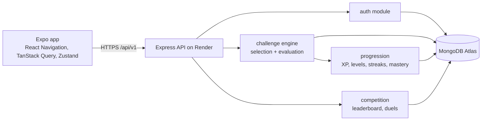

# Architecture — Luna

> Last updated: 2026-11-26 — Planned in P0, brought in line with the code in P6. Update whenever the build diverges.

## 0. Delivery setup

Confirmed in chat on 2026-11-22 (see `decisions.md` D-002, D-005, D-006).

- **Testing:** backend API tests only. Vitest + Supertest + mongodb-memory-server. The tests live in
  `.scratch/api-tests/`, which is **gitignored and never pushed**. There is no TDD requirement and
  no coverage target. The frontend is tested by hand (Rajdeep, using a checklist).
- **Deployment:** backend on **Render** (free web service), database on **MongoDB Atlas** (free M0).
  The mobile app runs through **Expo Go** in development. For V1 an installable Android **APK** is
  built by **EAS Build** (profile `apk` in `app/eas.json`, pointed at the production API) and attached
  to a GitHub Release (D-044). No Play Store or App Store builds.
- **Docker:** none.
- **CI:** none. **CD:** Render's git integration auto-deploys `server/` from `main`.
- **Always on, locally, before every commit:** ESLint + `tsc --noEmit` for every workspace.
  `.env` is gitignored, and `.env.example` documents every variable.
- **Git flow:** one branch per phase (`phase/p<n>-<slug>`). When the phase is done, merge it into `main`
  and push. **No pull requests.** Backend phases get one backend code review before the merge.

> UI design system: `docs/product/ui-design.md` (approved). Game rules: `docs/product/`.

## 1. Overview

An Expo (React Native, TypeScript) app talks over HTTPS/JSON to a stateless Express API
(TypeScript), which stores everything in MongoDB Atlas through Mongoose. The server owns all game
logic: it chooses challenges, hides answer keys, evaluates answers, awards XP, updates streaks and
topic progress, ranks the leaderboard and settles duels. The app is a thin client that renders
challenge data and shows results. A small `shared/` package holds the Zod schemas and TypeScript
types for the API contract, so the app and the server can't drift apart.

## 2. Component diagram



## 3. Tech stack

| Layer | Choice | Why |
|---|---|---|
| Mobile | Expo (latest stable SDK), React Native, TypeScript | Course requirement. Expo Go means no native build setup (D-003) |
| Navigation | **React Navigation** (native stack + bottom tabs), not Expo Router | Chosen by Rajdeep (D-003) |
| Server state | TanStack Query | Caching, retries, loading and error states (D-003) |
| Client state | Zustand | Auth token and in-progress session UI state only (D-003) |
| Token storage | expo-secure-store | Keychain/Keystore, not plain AsyncStorage (D-003) |
| Backend | Node.js (LTS), Express 5, TypeScript | From the brainstorm. Express 5 forwards async errors (D-003) |
| Validation | Zod, shared between app and server | One schema validates on the server and types on the client (D-004) |
| Database | MongoDB Atlas + Mongoose | From the brainstorm (D-003). No multi-document transactions (D-015) |
| Auth | JWT (HS256) + bcrypt | From the brainstorm (D-008) |
| Security middleware | helmet, cors, express-rate-limit | Engineering baseline |
| Logging | pino + pino-http | Structured JSON logs, cheap |
| API tests | Vitest, Supertest, mongodb-memory-server | Smoke tests in gitignored `.scratch/` (D-005, D-015) |
| Hosting | Render + Atlas M0 | Free, auto-deploy from `main` (D-006) |
| Package manager | npm workspaces | No extra tool. Expo supports npm monorepos (D-004) |

## 4. Codebase layout

```
luna/
├── app/                      Expo app (React Native). UI only, no game rules
│   ├── App.tsx               fonts, providers, RootNavigator
│   └── src/
│       ├── navigation/       RootNavigator, AuthStack, OnboardingStack, MainTabs, AppStack, typed params
│       ├── screens/          one folder per area: auth, onboarding, dojo, explore, game, duel, board, profile
│       ├── api/              fetch client (timeout, GET retries, envelope parsing), endpoints, query client
│       ├── store/            Zustand: auth (token in SecureStore), onboarding, connection (cold start)
│       ├── art/              Kiri-e Den cut-paper art as react-native-svg components on a 390-wide grid:
│       │                     DojoScene, Lantern, RankScroll, Enso, KataScroll, EmaPlaque, YokaiMask,
│       │                     HankoStamp/HankoStrike, TopicBanner, ModeArt, FaceOff, Crest, WinSeal, Kanji
│       │                     (brush kanji baked to paths in kanjiPaths.ts by app/scripts/bake-kanji.mjs)
│       ├── components/       interaction kit: PressableSink, Button, OptionRow, CodeBlock, CodeCells,
│       │                     BrushMarks, TextField, YokaiAvatar, ErrorState, EmptyState, WakingServer
│       ├── lib/              session position, haptics, motion (Reduce Motion), duel formats, small hooks
│       ├── config/env.ts     the only module that reads process.env in the app
│       └── theme/            colours, spacing, typography, fonts
├── server/                   Express API
│   └── src/
│       ├── config/           env (Zod), game.ts (every game rule as data), security.ts (auth + rate limits)
│       ├── modules/<name>/   <name>.routes.ts → <name>.service.ts (+ helpers, repository where shared):
│       │                     auth, users, topics, challenges, sessions, progress, daily,
│       │                     leaderboard, duels, achievements, health
│       ├── models/           Mongoose schemas + indexes
│       ├── middleware/       requireAuth, validate (body, ObjectId param, query), rateLimit, errorHandler
│       ├── lib/              logger, errors, http envelope, time (timezone and week helpers), random
│       ├── db/               connect, syncIndexes
│       └── seed/             seed script, content schema check, audit, content/ (the question bank):
│                             finished V2 topics get a folder content/<topic>/{trace,bugHunt,choice,incidents}.ts
│                             (jsAsync/, httpApis/ since P10; databases/, cachingQueues/ since P11; debuggingProd/
│                             since P12). Full bank: 270 singles + 20 incidents, `audit:content --strict` clean
├── shared/                   Zod schemas + TS types for the API contract (runtime dependency: zod only)
├── docs/                     prd, architecture, build-plan, decisions, product/ (game rules), luna-idea
├── .scratch/                 GITIGNORED. API smoke tests and throwaway scripts, never pushed
└── package.json              npm workspaces: shared, server, app
```

## 5. Modules and responsibilities (server)

| Module | Owns | Depends on | Must not |
|---|---|---|---|
| auth | register, login, JWT issue/verify, password hashing | users repo | return passwordHash |
| users | profile, onboarding fields, `/users/me` | — | change XP or streak directly |
| topics | topic list | — | — |
| challenges | challenge repo, public projection (no answer key) | — | send `answerKey` / `stages[].answerKey` |
| sessions | start session, submit answer, complete session | challenges, progress, daily, achievements | trust client time or correctness |
| progress | XP ledger, levels, streaks, topic progress, mastery, adaptivity | — | award XP twice for the same source |
| daily | build or return today's Daily Kata per user | challenges, progress | build two circuits for the same user and day |
| leaderboard | weekly ranking aggregation | progress (XP ledger) | scan unbounded results |
| duels | create, join, play, settle (expiry, forfeit, winner, win bonus), list | sessions, progress (XP ledger) | let a user join their own duel; count a finish after the deadline |
| achievements | evaluate and award badges after session events | progress | award the same badge twice |

## 6. Layering rules

`routes` (path, auth, validation, then one service call and the envelope) → `service` (business rules)
→ repository or model (Mongoose queries) → `models`. There is no separate controller layer: the route
handlers are one-liners, so a controller file would only forward arguments. Route handlers never touch
models; services never touch `req`/`res`. Only `src/config` reads `process.env`. In the app: screens → TanStack
Query (`src/api` endpoints) → fetch client. Screens never call `fetch` directly.

## 7. External services

| Service | Used for | Failure impact |
|---|---|---|
| MongoDB Atlas M0 | all data | API returns 503 `DB_UNAVAILABLE`, the app shows the error state with Retry |
| Render free web service | hosting the API | sleeps after idle. The first request is slow (up to ~50 s). The app shows "Waking the server" after 4 s; each request times out at 15 s and GETs retry twice with backoff |

## 8. Auth and authorization

- Register: email (lowercased, unique), password (8–72 chars, bcrypt cost 12), username
  (3–20 chars, `[a-z0-9_]`, unique, case-insensitive).
- Login returns a JWT (`sub` = userId, 7-day expiry). The app stores it in SecureStore and sends
  `Authorization: Bearer <token>`. No refresh tokens in V1 (D-008).
- `requireAuth` middleware on every route except `/health`, `/auth/register` and `/auth/login`.
- AuthZ per resource: sessions, attempts and progress are always queried with `userId = req.user.id`.
  Duels can only be read by the creator or the opponent.
- Rate limits (`config/security.ts`): `/auth/*` 10 requests per 15 min per IP, plus a per-account lock
  after 5 failed logins for 15 min. Duel join 30 per 15 min per IP. Global 300/min per IP.
- No cookies, so no CSRF surface. CORS: the app is native and sends no Origin, so CORS only allows
  configured origins (Expo web dev), and everything else is refused by default.

## 9. Error handling and logging

- Success envelope: `{ "data": ... }`. Paginated lists: `{ "data": { "items": [...], "nextCursor": "..." | null } }`
  (the Dojo Board uses `rows` + `nextCursor`, plus its `me` row).
- Error envelope: `{ "error": { "code": "VALIDATION_ERROR", "message": "Human-readable", "details"?: [...] } }`.
- Codes: `VALIDATION_ERROR` 400, `UNAUTHORIZED` 401, `FORBIDDEN` 403, `NOT_FOUND` 404,
  `CONFLICT` 409, `RATE_LIMITED` 429, `INTERNAL` 500, `DB_UNAVAILABLE` 503.
- A central error handler maps an `AppError` to the envelope. Unknown errors are logged with the stack
  and returned as `INTERNAL` with no internal details.
- pino logs JSON; pino-http tags each request line with a request id. Never log passwords, tokens or `answerKey`.
- App: the fetch client has a 15 s timeout, retries GETs twice with backoff, and never retries
  POSTs automatically. Writes are idempotent (see §12), so the user can retry by hand safely.

## 10. Configuration

| Env var | Purpose | Required | Example |
|---|---|---|---|
| `NODE_ENV` | environment | yes | `development` |
| `PORT` | API port | no (8080) | `8080` |
| `MONGODB_URI` | Atlas connection string | yes | `mongodb+srv://...` |
| `JWT_SECRET` | signing secret, ≥32 chars | yes | — |
| `JWT_EXPIRES_IN` | token lifetime | no (`7d`) | `7d` |
| `CORS_ORIGINS` | comma-separated allowed origins | no | `http://localhost:8081` |
| `LOG_LEVEL` | pino level | no (`info`) | `debug` |
| `EXPO_PUBLIC_API_URL` | (app) API base URL | yes | `http://192.168.1.5:8080/api/v1` |

Game constants (XP table, bonuses and caps, level thresholds and names, mastery and adaptivity
thresholds, Kata/duel composition, duel timer, expiry and open limit) live in `server/src/config/game.ts`,
not as magic numbers. Their values come from `docs/product/` (approved).

## 11. Data model

| Collection | Key fields | Indexes / constraints |
|---|---|---|
| users | email, username, usernameLower, passwordHash (select: false), avatarId, preferredTopicSlugs, experienceLevel, onboardedAt, totalXP (level and rank are computed from it, not stored), currentStreak, longestStreak, lastDailyDate (`YYYY-MM-DD` local), timezone (IANA) | unique email, unique usernameLower |
| topics | slug, name, description, icon, order | unique slug |
| challenges | slug, title, topicSlug (slugs are stable, so no join to topics is needed), subtopic, type (`TRACE`/`BUG_HUNT`/`ENGINEER_CHOICE`/`INCIDENT`), difficulty 1–3, prompt, codeSnippet?, options[{id,text}], answerKey, explanation, misconception, optionFeedback?, hint?, estimatedTimeSec (XP comes from difficulty via config), stages[] (incident only: title, evidence, prompt, options, answerKey, explanation), rootCause?, isActive | unique slug; `{topicId, type, difficulty, isActive}` |
| sessions | userId, type (`PRACTICE`/`DAILY`/`INCIDENT`/`BASELINE`/`CHECKPOINT`/`DUEL`), topicId?, mode? (`TRACE`/`BUG_HUNT`/`ENGINEER_CHOICE`, PRACTICE mode rounds), dailyDate?, duelId?, duelFormat? (DUEL), endedEarly (Sudden Death), items[{challengeId, order, optionOrders[][], isRevisit, hintsUsed[]}], status (`ACTIVE`/`COMPLETED`), startedAt, completedAt, correctCount, totalQuestions, totalTimeMs, totalXP | `{userId, createdAt:-1}`; unique partial `{userId, dailyDate}` (type DAILY); unique partial `{userId, type, topicSlug, mode}` (ACTIVE PRACTICE/BASELINE/CHECKPOINT); unique partial `{duelId, userId}` (type DUEL); `{userId, status, completedAt:-1, _id:-1}` (history) |
| answerattempts | userId, sessionId, challengeId, stageIndex (0 for non-incident), answer, isCorrect, usedHint, isTimeout, timeTakenMs (server-measured), topicId, difficulty, createdAt | **unique `{sessionId, challengeId, stageIndex}`** (blocks double submits); `{userId, challengeId}`; `{userId, topicId, createdAt:-1}` |
| usertopicprogress | userId, topicSlug, answers, correct, recentResults (last 10 booleans, mastery), adaptWindow (answers since last difficulty change, max 5), difficultyLevel 1–3, hasAdvancedCorrect, lastPractisedAt | unique `{userId, topicId}` |
| xpevents | userId, sourceKey (`challenge:<id>[:<stage>]`, `review:<date>:<id>`, `daily:<date>`, `perfect:<date>`, `first-incident`, `streak<N>:<runStart>`, `duelwin:<localDate>:<1..3>`), amount, weekKey (`2026-W47`), createdAt | **unique `{userId, sourceKey}`** (first-completion XP only); `{weekKey, userId}` |
| revisititems | userId, challengeId, topicSlug, missedAt, missedDate (local `YYYY-MM-DD`), notBeforeDate? (set when a revisit is missed again) | unique `{userId, challengeId}`; `{userId, missedAt}` |
| duels | code, creatorId, opponentId?, format (`CLASSIC`/`BLITZ`/`SUDDEN_DEATH`), items[5 or 10]{challengeId, optionOrders[][]}, status (`OPEN`/`ACTIVE`/`COMPLETED`/`EXPIRED`), creatorResult?/opponentResult? {correct, totalTimeMs, finishedAt}, winnerId?, endReason (`PLAYED`/`FORFEIT`/`EXPIRED`), winBonusClaimed, winBonusSettled, winBonusXP, expiresAt | unique code; TTL-free (expiry checked on read); `{creatorId, createdAt:-1}`, `{opponentId, createdAt:-1}`. A player's DUEL session is found by `{duelId, userId}` |
| revisits | userId, challengeId, answersAtMiss, notBefore (date), status | unique `{userId, challengeId}` while open; `{userId, status, notBefore}` |
| userachievements | userId, key, awardedAt | unique `{userId, key}` |

## 12. Key flows and failure handling

**Submit answer** (`POST /sessions/:id/answers`)
1. Load the session by `{_id, userId, status: ACTIVE}`. If it's missing, return 404. A session that is
   already completed returns 409.
2. Check that the challenge is part of the session (and the stage index is valid for incidents).
3. Evaluate against `answerKey` on the server. `timeTakenMs` = now − (previous attempt time or
   `startedAt`), capped at 10 minutes. Client time is ignored.
4. Ordered single-document writes, **no multi-document transaction** (D-015): first insert the
   AnswerAttempt (the unique index makes a double tap a 409 that the app treats as "already answered"
   and re-fetches). Then update UserTopicProgress atomically with `$inc` and `$push` + `$slice: -10`. If the
   answer is correct, insert an XpEvent `challenge:<id>`: a duplicate key means "already earned", so no XP;
   otherwise `$inc users.totalXP`. Because the attempt is written first, a crash between steps can at
   worst lose a progress update. It can never double-award XP.
5. Return `{ isCorrect, correctAnswerId, explanation, misconception, xpEarned, nextStage? }`.

**Complete session** (`POST /sessions/:id/complete`): `findOneAndUpdate({status: ACTIVE} → COMPLETED)`,
so only the first call does the work, and repeats return the stored summary (idempotent). For DAILY
sessions it also awards the daily bonus XpEvent `daily:<date>` and updates the streak with a
conditional update on `lastDailyDate`, then runs the achievement checks.

**Daily Kata** (`GET /daily`): compute the user's local date from `users.timezone`. The Kata *is* a
`DAILY` session with `dailyDate` set; a unique partial index on `{userId, dailyDate}` (type `DAILY`)
means two concurrent first opens produce a single Kata, because the loser re-reads the winner's (D-028).
Answers to a Kata whose day has ended are refused with 409, so a completed Kata was always played on its
own day. Selection: 1 TRACE, 1 BUG_HUNT, 2 ENGINEER_CHOICE,
1 INCIDENT. Prefer unseen challenges at the user's per-topic difficulty, include up to 2 previously
missed ones (missed ≥3 questions ago), and weight towards weak and preferred topics. Fall back to any
active challenge of that type if a pool is empty.
Candidate pools come from `challengesRepo.findActive`, bounded by `SELECTION.poolMax` (1,000, D-050); the
bound must stay above the whole active bank, or cross-topic picks silently lose the last topics.

**Selection variety (V2, D-048).** Every set (Kata slots, practice and mode rounds, incidents,
checkpoint, baseline, duels) is drawn by weighted random sampling (`server/src/lib/sampling.ts`, random
source `crypto.randomInt`, injectable for tests), not "best score". Hard tiers come first: unseen before
seen, then nearest difficulty; sampling happens only inside the best tier. Inside it the weight is
`exp(-softScore / SELECTION.temperature)` (preferred/weakest topic, topic spread). "Seen" means answered,
or served in one of the player's sessions in the last `SELECTION.recentDays` days (at most
`recentSessionsMax` sessions, read through the `{userId, createdAt}` index), so an abandoned round is not
replayed. The Kata is still stored per user and day, so reopening returns the same set. A duel is picked
once and shared by both players.

**Content audit** (`npm run audit:content -w server`, dev only, not in the server build): validates the
bank and reports coverage against `CONTENT_TARGETS` (benchmarks.md §4). Errors exit 1; `--strict` makes
an under-target cell an error.

**Streak** (local calendar day in `users.timezone`): same day → no change; yesterday → +1;
otherwise → 1. `longestStreak = max(...)`. A timezone change can't be used to farm streaks,
because the streak only moves when a Daily Kata completes and `lastDailyDate` is compared as a date string.

**Duel:** create → random 6-character code from an unambiguous alphabet (no 0/O/1/I), retry on unique
collision (up to 5 times). Join → atomic `findOneAndUpdate({code, status: OPEN, opponentId: null,
creatorId: {$ne: me}, expiresAt > now})`, so only one opponent can ever join. Both play DUEL sessions
on the same `challengeIds`. Result is computed when both sessions are COMPLETED: more correct wins,
then lower `totalTimeMs` (compared in whole seconds), else draw. Duel sessions still earn first-completion XP
(same ledger rules). Details of what P5 built (D-032):
- *Play:* `POST /duels/:id/play` creates the player's DUEL session on the duel's fixed challenges and option
  order. The unique `{duelId, userId}` index turns a double tap into one session.
- *Formats (D-042):* `DUEL_FORMAT_RULES` in `shared` sets each format's size and clock: Classic 5 × 60 s (5 s
  grace), Blitz 10 × 10 s (2 s grace), Sudden Death up to 10 × 30 s (5 s grace). The duel stores its format and
  each DUEL session copies it, so an answer reads its timer without a second query.
- *Timer:* the format's timer per challenge on the server's clock, measured from the previous answer. An answer
  later than the timer plus its grace, or the `TIMEOUT` answer the app sends at zero, is wrong and records
  exactly the timer.
- *Sudden Death:* answers must come in order. The first miss or timeout sets `endedEarly` (a conditional update)
  and reports `sessionReadyToComplete`; later answers return 409. Completion accepts fewer answers than the total
  only when `endedEarly` is set, and the score counts the run up to and including the first miss.
- *Settle:* when a DUEL session completes, the player's score is written onto the duel only if the duel is live
  and before `expiresAt`. Every read of a duel then settles it: both scores → `COMPLETED`/`PLAYED`; past expiry →
  the player who finished wins by default (`FORFEIT`, no bonus), or `EXPIRED` if nobody finished or joined. Each
  transition is a conditional update guarded on the fields it depends on.
- *Win bonus:* claimed once per duel (`winBonusClaimed` false→true), then paid into the first free daily slot
  `duelwin:<date>:1..3`, so the 3-per-day cap is enforced by the ledger's unique index.

**Dojo Board** (`GET /leaderboard/weekly`): one aggregation over this week's `xpevents` grouped by user, sorted by
XP, then by who reached it first (earliest last award), then id. Pages are offsets inside the top 50; the `me` row
comes from the same aggregation. Last week's top 3 is a second aggregation with `$limit: 3`.

**Mode rounds and boss incidents (D-041):** `POST /sessions` PRACTICE with `mode` builds a round of one challenge
kind: the topic's own challenges first (one due revisit, then unseen, nearest the player's difficulty), topped up
to five from the same kind in other topics. INCIDENT with `topicSlug` picks that topic's boss incident and falls
back to any incident.

**Player stats:** `GET /users/me/progress` includes `stats` (Katas completed; duels won, lost and drawn) from four
indexed counts on sessions and duels. There are no counters to keep in sync.

**Achievements:** checked right after a session flips to `COMPLETED`, from cumulative counts (completed sessions,
correct Bug Hunt answers, completed Katas, perfect Katas). A missed check catches up on the next completion. Newly
earned ones ride on that one completion response, like `rankUp`.

**First bottleneck:** the leaderboard aggregation over `xpevents` per request. Fine at capstone
scale with the `{weekKey, userId}` index. Later: a cached `weeklyXP` counter per user with a
`weekKey` (see `TODOS.md`).

## 13. Test plan

| Layer | Covers | Tool | Command |
|---|---|---|---|
| API smoke tests (gitignored) | critical paths: auth and lockout, answer-key leakage, double submit, XP once, streak, Daily Kata once, mastery and adaptivity, revisits, board, achievements, mode rounds and boss incidents, duel join race, timers per format, Sudden Death, tie-break, expiry, win-bonus cap, content audit, weighted sampling, per-player selection variety (89 tests) | Vitest + Supertest + mongodb-memory-server | `cd .scratch/api-tests && npx vitest run` |
| Frontend | each phase's click-through checklist | manual on Expo Go (Rajdeep) | — |
| Static | lint + typecheck all workspaces | ESLint, tsc | `npm run lint && npm run typecheck` |

## 14. Infrastructure

### CD / deployment
- **Render web service** (set up in P6): root directory = the **repo root** (not `server/`: the
  server depends on the `shared` workspace and the lockfile lives at the root). Build
  `npm ci --include=dev && npm run build -w server` (`--include=dev` because `NODE_ENV=production`
  makes npm skip devDependencies, and `tsup` is one). Start `npm run start -w server`. Health check
  `/api/v1/health`. Auto-deploys on push to `main`. Env vars: `NODE_ENV=production`, `MONGODB_URI`
  (`luna_prod`), `JWT_SECRET` (a new one, not the dev secret), `LOG_LEVEL=info`. Render sets `PORT`.
- **MongoDB Atlas M0:** one cluster, separate databases `luna_dev` and `luna_prod`.
  Network access: `0.0.0.0/0` (Render free tier has no static IPs). Protected by a strong DB user
  password. This trade-off is logged in D-006.
- **App:** `npx expo start`, scanned with Expo Go. `EXPO_PUBLIC_API_URL` points at the LAN IP in dev
  and the Render URL for the demo.
